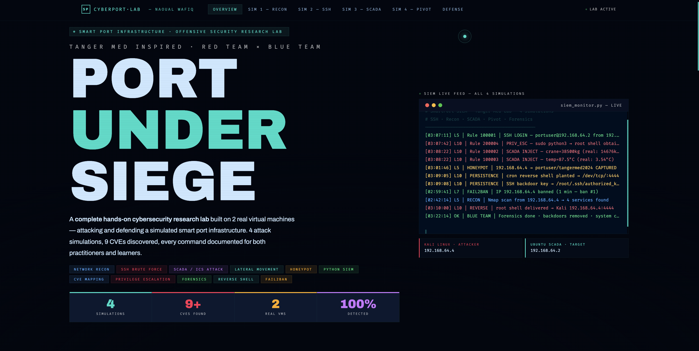

# 🚢 Smart Port Cybersecurity Lab — Red Team × Blue Team

> **Summary:** A self-built, fully isolated 2-VM lab simulating the IT/OT network of a smart container port, used to run **4 end-to-end attack simulations** and then **detect, investigate and remediate** each one.
> **Key results:** 9 CVEs mapped (incl. an unauthenticated SCADA service, CVSS 10.0) · SSH credential cracked from an OSINT wordlist · SCADA sensor values falsified via MitM · root obtained through a misconfigured `sudo` rule · all 4 simulations detected · 2 persistence backdoors found and removed.

*Academic project — Cybersecurity, ENSA Tangier. Full report: [`report/Smart_Port_Security_Lab.pdf`](report/Smart_Port_Security_Lab.pdf).*

🌐 **Live interactive site:** [cyberport-naoual.netlify.app](https://cyberport-naoual.netlify.app/) — all 4 simulations, SIEM live feed, and Blue Team defense summary, browsable online.



> ⚠️ **Scope & ethics.** No affiliation with any real port operator. **No real system or network was ever accessed or tested** — every action targeted my own two isolated virtual machines (UTM / Apple Silicon, NAT only). The lab is *inspired by* public reporting on maritime-port incidents; all credentials were created for the lab, and all CVEs referenced are publicly documented with available patches.

---

## 🎯 Why this lab

A modern port runs cranes, refrigerated containers and fuel systems on the **same IP network** as its web servers and SSH — IT/OT convergence. The lab reproduces that convergence on two VMs to show, from first principles, how one misconfigured service becomes a path from a laptop to a physical actuator, and how a defender catches it.

| | Attacker (Red) | Target (Blue) |
|---|---|---|
| OS | Kali Linux 2024 | Ubuntu 24.04 LTS (`serveur-SCADA`) |
| Role | Offensive operations | SCADA service + defense/monitoring |
| Network | NAT 192.168.64.0/24 — isolated | same |
| Hypervisor | UTM / Apple Silicon | UTM / Apple Silicon |

**Target services:** SSH (OpenSSH 9.6p1), HTTP (Apache 2.4.58), Squid proxy, a custom Python **SCADA service on :5020 with no authentication**, and MySQL bound to localhost.

---

## ⚔️ The four simulations

Each simulation is mapped to a real, publicly reported class of port incident, then followed immediately by the defensive view. Full technical write-up (commands, logs, scripts) for each one lives in its own folder:

| # | Simulation | Folder | Key Result |
|---|---|---|---|
| 1 | Network Reconnaissance & CVE Mapping | [`sim1_recon/`](sim1_recon/) | 9 CVEs found, incl. CVSS 10.0 |
| 2 | SSH Brute Force, Honeypot & Fail2ban | [`sim2_ssh_bruteforce/`](sim2_ssh_bruteforce/) | Password cracked in 4 attempts, 47 captures |
| 3 | SCADA / ICS Man-in-the-Middle | [`sim3_scada_mitm/`](sim3_scada_mitm/) | Crane 15,709 kg → 38,500 kg injected |
| 4 | Lateral Movement & Privilege Escalation | [`sim4_lateral_movement/`](sim4_lateral_movement/) | Root in 1 command, 2 backdoors removed |

### Sim 1 — Network reconnaissance & CVE mapping
- **Method:** host discovery, then a service/version scan, then a Python script ([`recon_analyzer.py`](sim1_recon/recon_analyzer.py)) that maps discovered versions to known CVEs.
- **Result:** 3 hosts, 4 open ports, **9 CVEs** including 4 critical — an **unauthenticated SCADA service (CVSS 10.0)** and an **open Squid proxy** (an unexpected finding that would let traffic pivot through the port's own IP).
- **Defense takeaway:** patch management and attack-surface reduction; the open proxy and the zero-auth service should never be reachable.

### Sim 2 — SSH brute force, honeypot & Fail2ban
- **Red:** an OSINT-style wordlist ([`tangermed_wordlist.txt`](wordlists/tangermed_wordlist.txt)) — organisation name, year, maritime terms — against SSH. The weak password fell on the 4th attempt.
- **Blue:** a **Paramiko SSH honeypot** ([`ssh_honeypot.py`](sim2_ssh_bruteforce/ssh_honeypot.py)) silently logged **47 credential attempts** across 3 waves, and **Fail2ban 1.1.0** ([`jail.local`](sim2_ssh_bruteforce/jail.local)) applied progressive bans (3 strikes, ban time doubling, capped at 24 h).
- **Defense takeaway:** strong passwords + mandatory MFA, plus a honeypot as cheap early-warning threat intel.

> *Note on Fail2ban:* the repo version (1.0.2) was incompatible with Python 3.12 (removed `asynchat` module), so 1.1.0 was built from source — a small real-world troubleshooting step I document in the report.

### Sim 3 — SCADA / ICS man-in-the-middle
- **Red:** ARP spoofing to sit between the target and the gateway, capture SCADA traffic, and **inject false sensor values** ([`inject_v2.py`](sim3_scada_mitm/inject_v2.py)) — crane weight and container temperature pushed far past safe thresholds.
- **Blue:** a **Wazuh** rule flagged the impossible crane-weight reading as a critical anomaly.
- **Defense takeaway:** SCADA must not run cleartext without authentication or integrity; segment OT onto its own VLAN and add mutual TLS. **This is the part with physical-safety impact** — an operator could be watching "safe" values while equipment runs past its limits.

### Sim 4 — Lateral movement & privilege escalation
- **Red:** reuse the cracked SSH credential for a foothold, find a **misconfigured `NOPASSWD` sudo rule on a Python interpreter** (a deliberately planted, very common admin mistake — [explained here](sim4_lateral_movement/gtfobins_explained.md)), escalate to root, and plant two persistence mechanisms.
- **Blue — forensics (Phase 6):** reconstruct the full timeline from `last`, `auth.log` and the root crontab using [`forensics.sh`](sim4_lateral_movement/forensics.sh), then **locate and remove both backdoors** and confirm the system is clean.
- **Defense takeaway:** least privilege — never grant `NOPASSWD` on interpreters — and log review that closes the loop from breach to remediation.

---

## 🛡️ Defense summary (priority)

Full detection engine: [`defense/siem_rules.py`](defense/siem_rules.py).

| Priority | Recommendation | Why |
|---|---|---|
| CRITICAL | Authenticate & encrypt the SCADA service, isolate OT on its own VLAN | Removes the CVSS 10.0 path entirely |
| CRITICAL | Remove `NOPASSWD` sudo on interpreters | Was the single step from user to root |
| CRITICAL | Strong passwords + MFA on SSH | Defeats the brute-force chain |
| HIGH | Lock down the open Squid proxy; patch the 7 patchable CVEs | Known fixes available |
| MEDIUM | Add IDS/IPS (Suricata/Snort) alongside Fail2ban + Wazuh | Fail2ban + SIEM is a start, not enough alone |

---

## 💡 What I learned
- **The attack chain is interconnected:** recon found the pattern, brute force cracked it, misconfiguration escalated it — fixing any one link at the right point breaks the chain.
- **One misconfiguration can mean full compromise**, so least privilege is not optional.
- **In OT, data integrity is a safety issue**, not just a confidentiality one.
- **Detection works when configured and monitored** — every simulation here was caught — but I'm still deepening my Wazuh/SIEM skills beyond the default ruleset.
- **Forensics closes the loop:** a breach you can fully reconstruct and clean is different from a persistent compromise.

## ⚠️ Honest limitations
- Simplified 2-VM setup; real port infrastructure is far more complex and results shouldn't be extrapolated.
- "All 4 simulations detected" means exactly that — 4 attacks I launched myself in an environment I controlled, not a general detection guarantee.
- My Wazuh use is basic (agent + largely default rules); the honeypot, Fail2ban and forensic steps are the parts I can explain in most depth.

---

## 📁 Repository structure

```
cyberport-lab/
├── sim1_recon/              → Nmap scan + CVE analyzer script
├── sim2_ssh_bruteforce/     → Hydra, honeypot script, Fail2ban config
├── sim3_scada_mitm/         → ARP spoof + injection script
├── sim4_lateral_movement/   → Privilege escalation + forensics script
├── defense/                 → SIEM rules + recommendations
├── wordlists/                → OSINT wordlist used for Sim 2
├── report/                    → Full PDF report
└── assets/                    → Screenshots
```

---

`red-team` · `blue-team` · `ics-security` · `scada` · `ot-security` · `wazuh` · `fail2ban` · `honeypot` · `python` · `network-security`

**Author:** Naoual Wafiq — Cybersecurity Engineering Student (Cyber Defense), ENSA Tangier
🌐 [Live demo](https://cyberport-naoual.netlify.app/) · 💼 [LinkedIn](https://www.linkedin.com/in/nawal-wafiq-169210227)
